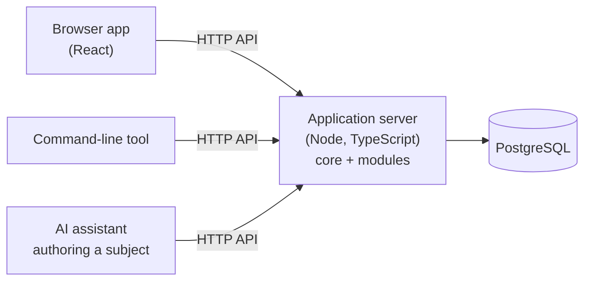

# Architecture

Skill Issue is a personal study application. You load a subject into it — source material, lessons and a bank of questions — and it takes you through the lessons, tests you, brings questions back when you are about to forget them, and keeps the notes you write on the way.

This document sets the frame the application is built inside. It states each choice with its reason, so that a later change can be weighed against what the choice was protecting.

## The four rules

Everything else follows from these.

1. **The application and the study material are separate things.** The application ships with no subjects. A subject is data, loaded through the API. Loading a subject, a lesson or a question never changes the application.
2. **The API is the only way in.** The browser app, the command-line tool and an AI assistant writing a new subject all use the same HTTP API. There is no second path that writes to the database.
3. **A function is a module.** Lessons, exams, review, notes and progress are separate modules on a small core. A new function is a new module; it does not require changing the others.
4. **What you did is recorded once, and everything else is derived from it.** Every answer is appended to a log that is never edited. Review schedules, mastery and statistics are computed from that log and can be rebuilt from it.

## Shape



Two containers, started together with Docker Compose: the application server, which also serves the browser app, and the database. Nothing else is needed to run it.

## Technology

| Choice | Reason |
|---|---|
| **TypeScript throughout** — server, browser app, command-line tool | One definition of the content format serves all three and the published schema. The maintained reference implementation of the scheduling algorithm is a TypeScript library. A second language would mean writing the format and the scheduler twice. |
| **PostgreSQL**, one database | The application needs three kinds of storage: documents (lesson bodies, question definitions), relations (subject, area, lesson, question, source, prerequisite) and a time-stamped record of answers. PostgreSQL holds all three — JSON columns, foreign keys with recursive queries, and an append-only table — plus full-text search for notes. One database is one thing to install, back up and reason about. |
| **No separate graph or time-series database** | The relations are a shallow tree with a few cross-links, and the answer record grows by thousands of rows a year, not millions. Neither justifies its own server. Rule 4 keeps the door open: a derived store can be added later and filled by replaying the log. |
| **REST API described by OpenAPI**, generated from the schemas | The API is called by programs the application's author never sees — someone else's AI assistant, a script, `curl`. A plain HTTP API with a published description needs no client library. |
| **Zod schemas as the single definition of every content type** | The same schema validates an incoming request, types the server and browser code, and generates the JSON Schema and OpenAPI documents that authors read. The format cannot drift from its documentation. |
| **React single-page app, built with Vite, served by the application server** | One container serves both the API and the interface. Nothing in the interface needs server rendering. |
| **FSRS for review scheduling**, through its reference library | See "Review scheduling". |
| **oxlint with tsgolint for linting** | TypeScript 7 is the compiler, and typescript-eslint supports TypeScript only below 6.1. The rules that need types — a dropped promise, a `switch` that misses a case, an `any` leaking in from a library — run here on the TypeScript 7 compiler itself, so the linter cannot disagree with the build about a type. |
| **Docker Compose for running it** | One command starts everything, on any machine, with nothing installed but Docker. |

Library versions are pinned when the skeleton is built, from each project's current release page, and recorded in the lockfile, not here.

## Core and modules

### The core

The core is what every module needs and no module owns.

- **Catalogue** — subjects, areas, lessons, questions, sources and glossary terms: their identity, hierarchy, language and revisions.
- **Learning record** — the append-only log of everything the learner did.
- **Settings** — interface language, study preferences.
- **Module registry** — discovers modules and wires their routes, migrations, navigation entries and commands.
- **Platform** — database access, migrations, validation, error format, logging.

### The module contract

A module is a folder. It declares itself through one manifest and may contribute any of:

- API routes, mounted under its own prefix
- database migrations for tables it owns
- what it shows in the browser app — see "The browser side" below
- commands in the command-line tool
- handlers for events in the learning record
- message catalogues for its interface text

Rules for modules:

- A module depends on the core. **It never imports another module.**
- A module owns its tables. No other module reads or writes them.
- Modules meet through the core: the catalogue for content, the learning record for what happened. Assessment appends an answer; review reads it. Neither knows the other exists.
- Removing a module's folder removes the function and breaks nothing else. A test asserts this for every module.

### The browser side

The browser app is a shell that draws two screens — the start screen and a subject's home — and names no module. Every other address is a module's page. Everything a module shows on them it contributes through its browser manifest, listed in one file in the browser app, so removing the module removes all of it. A module may contribute:

| Contribution | Where it appears | For example |
|---|---|---|
| a page, with or without a tab | the page at `/subjects/<subject>/<module>`, and everything below that address is the page's own; with a label, a tab beside the subject's overview and the subject's heading above it; without one it is reached from links and drawn alone, as a lesson is | the source library, and one source at `/subjects/<subject>/reader/<source>`; one lesson at `/subjects/<subject>/lessons/<lesson>`, reached from the path |
| a page outside the subjects | the page at `/<module>`, everything below it the page's own, under the app's header and with no tab; reached from links. `subjects` is the shell's own address and no module may take it as its id | a review of what is due in every subject, at `/review` |
| blocks on the subject home | `lead`, above the path, or `side`, in the column beside it | what is due today; a count of notes |
| figures on a start-screen row | beside each subject's title | reviews due, share mastered |
| a resume panel | above the start screen's rows; while it shows a subject, the other rows go compact under "Dina andra ämnen" without that subject | where the learner left off |
| a line across every subject | under the resume panels and above the rows, whether or not a panel shows | how many questions are due in all subjects, with a way into one session of them |
| which subjects are begun | each start-screen row's action: "Fortsätt" where begun, "Börja" where not, "Öppna" when no module says | the subjects with a lesson begun |
| lesson marks, in the interface language | on each lesson in the path, and wherever another module lists lessons | not started, in progress, passed, mastered |
| a lesson's address | each lesson on the path becomes a link, and so does a lesson another module names; given a step, the address opens the lesson at that step | the lessons module's page for one lesson; `/<step>` below it, counted from 1, as a note links back to where it was written |
| a source's address | each source a lesson rests on becomes a link | the reader's page for one source |
| how a step type is drawn | inside a lesson, by the module that owns the step; a check reports each answer, so the lesson asks a wrong one once more after its last step. Told where the pass through the lesson began, a check taken up again shows what was answered in it; a review draws its questions through the same contribution, one at a time, told they are a review | a check step, drawn and graded by assessment |
| something at a lesson's end | under the lesson's summary, once it is gone through | the offer to sit the lesson's exam |
| something at an area's foot | at the foot of each area on the path, whatever the learner has taken, since nothing is locked | the area's exam |
| something beside a lesson | next to the step on screen, closed until the learner opens it with its button under the step or its key, and closed again with either or with Escape; it is told the step on screen and can ask for the text selected in that step | the note pane, which quotes the selection |
| words marked in a lesson's text | in each text step, the first time the step names each one, by any of its forms, with a Swedish ending allowed after it and never inside a longer word; not in a heading, a link, code or an example step. Pointing at a mark, focusing it or clicking it opens its card straight after it, so Tab reaches the card's links before the next mark; Escape closes it. Where the lesson stands the cards beside the text instead, as on the workbench, no card opens over it: the lesson is told which marks the step holds and which is pointed at | the subject's glossary terms, each with its definition and the sources it rests on |

Lesson marks are the one contribution several modules give for the same thing: one module knows a lesson was started, another that its exam was passed. The shell shows the furthest state any module gives, and a lesson no marking module names as not started. With no marking module at all, the path is drawn without states, rather than claiming every lesson is untouched. A module whose marks cannot be read is left out, and the others still show.

Contributions meant for another module's page — a lesson's address, the marks, whoever draws a check, what sits beside a lesson, the words marked in its text — the shell gathers once and hands out on request (`shell/contributions.tsx`), so the module asking never names the one answering. Without the module that answers, the asker gets nothing and says so: a lesson is named but not linked, and a check step is a line saying a check is there, keeping its place so step numbers do not shift when the module arrives.

A page is given the path segments below its address, and a way to build an address within itself, so a page with places of its own — one source, one note — keeps them bookmarkable without the shell knowing what they are.

A module's interface text is its own: a message catalogue per interface language, beside its code, so removing the module removes its text and the shell's catalogue names no module. A language or a key left out of a module's catalogues does not compile.

The shell owns what needs no module: the subject list and each subject's path, read from the catalogue through the content endpoints, the interface language, and the states for a server or database that cannot be reached and a subject that does not exist. A loaded subject appears without a restart, because the start screen asks again every 30 seconds and whenever the tab is shown.

### Modules in the first version

| Module | What it does |
|---|---|
| `content` | Accepts, validates, versions and exports subject material. |
| `reader` | Shows source material, with its origin. |
| `glossary` | Marks a subject's terms in its lessons, and shows what each means and where that comes from. |
| `lessons` | Runs a lesson step by step and tracks where you are. |
| `assessment` | Checks inside lessons, and final exams per lesson and per area. Grades answers. |
| `review` | Schedules questions to come back, and runs review sessions. |
| `notes` | Notes written beside a lesson, filed by subject, area and lesson; browsing and search. |
| `progress` | Mastery per lesson and area, and learning over time. |
| `diagnostics` | An opt-in recording of a study session — interface events, API calls, errors — kept locally, for finding faults. |

Functions that are expected later and must fit without rework: a glossary trainer, flashcards written by the learner, study streaks and goals, an assistant that explains a wrong answer. Each is a module by the contract above.

## Content model

```
Subject
├── Source            a piece of raw material, with where it came from
├── Glossary term
└── Area
    └── Lesson
        ├── Step      text, example, figure, or a check
        └── Question  belongs to the lesson's bank
```

- **Subject** — the unit that appears in the start menu.
- **Area** — a group of lessons with an order and optional prerequisites.
- **Lesson** — an ordered list of steps. A step is a block of teaching text, a worked example, or a check that asks one or more questions from the lesson's bank.
- **Question** — one item in the bank. It has a type, the correct answer, an explanation shown after answering, the lesson and concepts it tests, and the sources it rests on.
- **Source** — raw material: the text itself or a summary, with title, publisher, URL, the date it was read, and its licence where known. Lessons and questions cite sources by reference.
- **Exam** — not a fixed list. An exam is a blueprint: how many questions to draw, from which lessons or concepts, in what mix of types, and the mark needed to pass. Adding questions to a bank improves every exam drawn from it.

### Question types

A question type is a plug-in to the assessment module: a schema for the question, a schema for an answer, a grading function, and an interface component. The first version has:

- single choice, multiple choice, true or false
- numeric answer with unit and tolerance
- short text matched against accepted answers
- ordering and matching
- free recall, graded by the learner against a shown answer

A new type is added by registering these four parts. Nothing else changes.

### Identity, revisions and language

- Every item has a stable identifier chosen by its author, unique within its subject.
- Loading a changed item creates a new **revision**. The learning record refers to the revision that was answered, so a corrected question does not rewrite history.
- Every item carries a **language**. The same identifier may exist in several languages; these are translations of one item. Progress and scheduling attach to the identifier, not the language, so switching language keeps what you have learned.
- A subject states its default language. An item missing in the chosen language falls back to the default and says so.
- Interface text lives in message catalogues, one per module and language. Content language and interface language are chosen separately.

## Learning record

One append-only table, `record.event`, owned by the core and handed to every module as `record` beside the catalogue. A row is written whenever the learner answers a question (`answer`), goes through a step (`step`), finishes a lesson (`lesson-finished`) or hands in an exam (`exam`). Every row names its item as it stood — subject, kind, id, language and revision — and the database holds it to a revision the catalogue has, so a row always points at the exact text the learner met. For an answer it holds:

- the item, its revision and the concepts it tests; the revision is that of the language the question was shown in
- when, in UTC to the millisecond, with the learner's time zone, which the browser sends with every answer and every move through a lesson
- what was answered, whether it was correct, and the score: every type is graded right or wrong today, so the score is 1 or 0
- how long it took: for a check, from the question being shown to the answer being sent; for an exam, the time the question was on screen over every visit, since the learner moves back and forth; nothing for an exam question left unanswered
- the question type and the number of options a guess would pick from: the choices, 2 for true or false, the items to order or the pairs to match, and nothing for a typed number, typed text or free recall
- the setting: lesson check, exam, scheduled review or extra practice
- the sources the question cited when answered, so a source later removed from the subject can still say what was answered on its strength
- for an exam's answers, the sitting

A step row says which step, counted from 0; moving on past several steps goes through each, and moving back goes through none. A lesson is finished each time the learner reaches its end from inside it, not when the end is merely saved again. An exam row holds the sitting, its mark against its pass mark, and its whole time from started to handed in; its answers and it are written in the same transaction as the hand-in, so neither exists without the other.

Rows are never updated or deleted: a trigger refuses both, so this is a property of the table and not of the code. Everything a module shows about progress is a view over this table or a table rebuilt from it.

A review answer is an answer like any other, with the setting "review". The scheduler's memory state is not in the record: it is derived, and replaying the record with the same scheduler reproduces it exactly, so the record keeps only what happened and whoever grades an answer need not know a scheduler exists.

Rows become visible in the order they are numbered: every append holds a transaction-scoped lock until its transaction ends, so a row that commits late, such as an exam's answers written with the hand-in, can never appear behind a higher-numbered one. A module that follows the record by row number therefore never passes a row over.

Besides appending, the record answers a few reads, so modules meet in the core rather than in each other's tables: the answers after a row, the latest answer to each of some questions in given settings, the row at which a lesson was last finished, a learner's typical time over one question, and what was answered on a source's strength.

## Review scheduling

Review uses **FSRS**, the algorithm behind current Anki, through its reference TypeScript library, `ts-fsrs`, pinned to an exact version, with the model pinned to FSRS-6, the one current Anki schedules with. Fuzz is off, so a replay gives exactly the state built live.

- Each question the learner has met has a memory state: how hard it is for them, and how stable the memory is. From these the algorithm estimates the chance of recalling it today and schedules the next review for when that chance falls to the target, 90 %.
- A check answered inside a lesson, an exam answer and a review answer all count as observations, so a question does not need a separate "card" to enter review.
- **Only the first answer to a question on a day counts**, the day being the learner's own, in their time zone. A second answer the same day — the round a lesson asks again, a wrong answer coming back in a session — is the learning itself; counting it would rate a question "good" minutes after it was forgotten.
- **Ratings.** Wrong is "again". Right is "good", unless a guess would hit the question one time in three or more often — true or false, a single choice among three or fewer, a matching of two — when it is "hard": the memory still grows, but a lucky guess does not send the question away for weeks. The chance of a guess comes from the type and the number of options the record keeps for each answer. Free recall is graded right or wrong by the learner today, so it gives "again" or "good"; offering it all four ratings needs a free-recall answer that carries them.
- **Scheduling is in whole days.** Short-term learning steps are off. A question is due once the day it falls due on has come in the learner's time zone, at any hour of it.
- **The memory is a view of the record**, in tables owned by the review module: each question's state, and how far into the record it has been brought and by which scheduler. Every read first folds in the answers written since, in order, under a lock so two reads fold each answer once. The scheduler is named by everything that changes a due date — library, version, model, retention, steps and fuzz — and a memory built by any other is thrown away and replayed from the first row. Changing the algorithm, or fitting its parameters to the learner's own history, is therefore a replay, not a migration.
- **A session** is what was due when it opened, asked one question at a time. A question answered wrongly returns later in the same session: behind the next three questions, or at the end when fewer are left. When it is the last one left it comes straight back, after its explanation has been shown — a bank too small to put anything between is not a reason to let it go unanswered. The session ends when every question in it has been answered right once, or when the learner stops; what is left stays due.

## API

- Versioned under `/api/v1`. The OpenAPI document is served by the application at `/api/v1/openapi.json`.
- **Content endpoints** accept one item or a whole subject. Loading is idempotent: the same content sent twice changes nothing. A whole subject is sent to `POST /api/v1/content/packs`, as JSON or as a zip archive of the pack folder.
- **Validation is strict and the errors are written to be acted on.** A rejected request returns a problem document listing every fault with the path to the offending field, what was expected and what was found. An AI assistant should be able to correct its output from the response alone.
- A **dry-run** flag validates without storing.
- **Export** returns a subject in the same format it is loaded in.

## Subject packs

A subject pack is a subject in file form: a folder of YAML and Markdown that mirrors the content model, with a `formatVersion`. The command-line tool validates a pack and loads it through the API; export writes one. A pack is the unit for sharing, reviewing and version-controlling a subject.

### Sharing a subject

A pack is made to be handed to someone else.

- Export writes a pack as a folder or as a single zip archive. Load accepts either.
- **A pack holds the subject and nothing about the person who studied it.** Notes, answers, progress and settings are never part of a pack; they belong to the personal backup.
- A pack names its format version and carries its own sources and assets, so it loads on any installation that supports that version, with no network access.
- Loading a pack whose subject identifier already exists is treated as an update of that subject and shows what would change before anything is stored. To keep both, the subject is loaded under a new identifier.
- An archive is unpacked defensively: entries that would land outside the pack folder are refused, and size and file count are bounded.

The format is specified in `content-format.md` and published as JSON Schema. It is versioned separately from the application: a pack written for an earlier format version keeps loading.

An **authoring guide** written for an AI assistant ships with the application. It explains how to research a subject, structure it into areas and lessons, write questions that test understanding, cite sources, validate and load the result.

## Storage

- Catalogue tables hold identity, hierarchy, language and revision; bodies are JSON validated by the schemas. They belong to the core, so that every module reads subject material the same way; the `content` module writes them through the core's catalogue service and owns no tables of its own.
- The core's migrations run before any module's, so a module's tables may refer to the catalogue. Migrations are ordered by code unit, never by the machine's locale, so that every installation applies them in the same order.
- The learning record is one table, indexed by time and by item.
- Each module's tables live in its own schema and are created by its own migrations.
- Notes are indexed for full-text search. The index uses PostgreSQL's `simple` configuration, which lowercases and splits words without stemming, because a note may be written in any language and a Swedish stemmer would mangle an English note; a search matches every word given at the start of a word, which does the work stemming would. A note is stored against its lesson and step only, never its area, so a lesson moved between areas takes its notes with it; one on a lesson the subject no longer holds is kept and listed apart.
- **Backup** is two exports: subjects as packs, and personal data — notes, settings and the learning record — as one archive. Restoring both on a fresh install reproduces the learner's state.

## Security

The application is for one person on one machine, and the design keeps it that way.

- The server is published on the loopback interface only. It is not reachable from the network.
- Subject material is untrusted input, because it may be written by someone else's assistant. Markdown is rendered through a sanitiser with raw HTML disabled; links open in a new context; no script from a pack is ever run.
- Images and other files in a pack are stored and served by the application. Remote images are not fetched.
- All database access uses bound parameters.
- No credentials are stored in the repository. The database password is generated once by a script, before the first start, and kept in a local file that is not committed.

## Testing

- **Linting** with type information from the same compiler that builds the code, and no warnings: a finding fails the run or is not a rule. The rules that matter are held by fixtures of deliberate violations, each line naming the rule that must report it, so a rule that goes silent fails the run.
- **Unit tests** for grading, scheduling, exam drawing and validation.
- **API tests** against a real PostgreSQL in a container — no mocked database.
- **Contract tests**: the example pack in the repository loads cleanly, and a set of deliberately broken packs each produce the expected error.
- **Module isolation test**: the application starts and passes its tests with any one module removed.
- **Browser tests** for each flow, driven end to end.
- Every feature is done when its tests pass and a stated validation step — a real action in the running application — has been carried out.

## Extending

| To add | Do this | Touch the application? |
|---|---|---|
| A subject | Write a pack, load it | No |
| A lesson or questions | Add files to a pack, load it | No |
| A translation | Add the items in another language under the same identifiers | No |
| A question type | Register schema, answer schema, grader and component | One new folder |
| A function | Write a module with a manifest | One new folder |
| An interface language | Add message catalogues | Catalogue files only |
